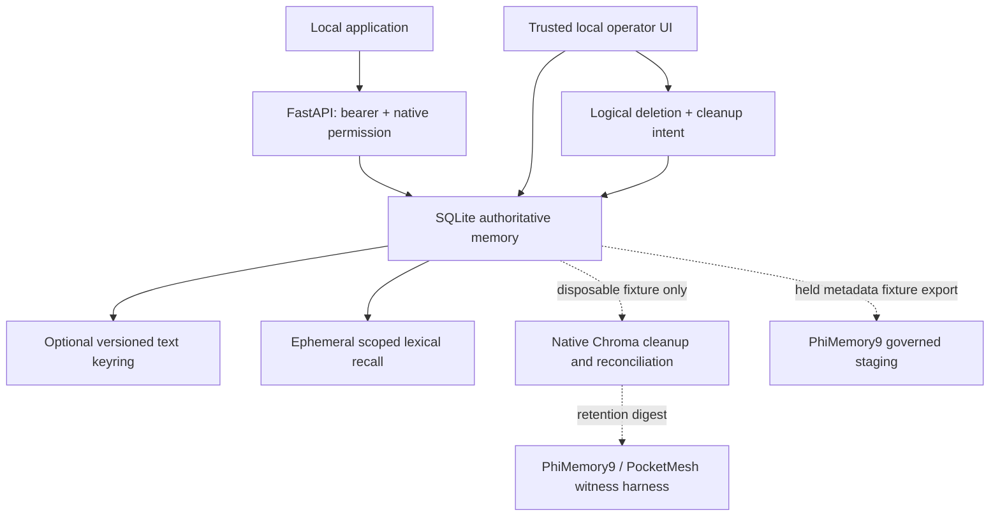

# Memoria

**Local-first persistent memory for the PHI369 ecosystem.**

[](https://github.com/MichaelWave369/Memoria/actions/workflows/genomememory-export.yml)
[](LICENSE)

Memoria began as the memory vault for Triad369 applications. It now supplies the native persistent-storage side of the Operation Living Memory research program: application-scoped SQLite storage, optional authenticated text encryption, bounded recall, and accountable logical forgetting.

**Status: R11 research candidate. Production and sensitive-data use remain HELD.** Green CI verifies particular fixture contracts, not a security certification.

## What works today

| Capability | Current boundary |
| --- | --- |
| Persistent memory | Local SQLite; text, application and agent identifiers, tags, timestamps, importance and metadata |
| Application access | Per-app bearer credential plus explicit native read/write permission; loopback HTTP only |
| Encryption | Explicit Fernet keyring; versioned authenticated text envelopes; optional, not full-database encryption |
| Recall | Bounded application-scoped lexical Jaccard ranking; IDs and rational overlap scores |
| Synthesis | Scoped tag counts over daily/weekly windows, up to 500 rows; not model-generated summaries |
| Operator interface | Trusted local Streamlit dashboard, explorer, capture, permission controls and snapshot export |
| Forgetting | Local operator SQL deletion with atomic durable intent; known secondary copies remain unverified |
| Vector cleanup and recovery | Native Chroma tests in explicitly bound disposable fixtures only |
| Retention continuity | Fixture-only keyed retention topology and pinned upstream signed-anchor tests |
| Relational retrieval | Offline authored benchmarks, ambiguity and provenance experiments; not live retrieval |

No vector index or model call is required for the scoped lexical route. The old Chroma/Ollama paths are retained for historical compatibility and research, not qualified for live use. The semantic route, application deletion and HTTP permission management remain held.

## Architecture



Memoria owns local storage. [PhiMemory9](https://github.com/MichaelWave369/PhiMemory9) develops governed lifecycles and consent, and [NBGPocketMesh](https://github.com/MichaelWave369/NBGPocketMesh) provides the pinned continuity-witness implementation used by fixture tests. GenomeMemory369 supplies the conceptual memory contract. These research connections do not establish a production service, automated transfer, or authority to express memory. Sovereign Memory Lattice integration is a future qualification step.

## Quick start (synthetic data only)

Python 3.11 is the CI reference. From a fresh clone:

### Windows PowerShell

```powershell
python -m venv .venv
.\.venv\Scripts\python.exe -m pip install -r requirements.txt
$env:MEMORIA_DB_PATH = "memoria-demo.db"
$env:MEMORIA_ENCRYPT_AT_REST = "0"
.\.venv\Scripts\python.exe -m streamlit run streamlit_app.py --server.address 127.0.0.1
```

### Linux / macOS

```bash
python3 -m venv .venv
.venv/bin/python -m pip install -r requirements.txt
export MEMORIA_DB_PATH=memoria-demo.db
export MEMORIA_ENCRYPT_AT_REST=0
.venv/bin/python -m streamlit run streamlit_app.py --server.address 127.0.0.1
```

Use a fresh demo database path; do not point this experiment at an old vault. The UI defaults to loopback (typically port 8501), and starts the embedded API on 127.0.0.1:8765. Do not expose either to a network. The direct operator UI is **not** an authenticated multi-user interface. Plaintext mode is intentional for this synthetic demo.

For API-only development, install `requirements-core.txt` and run:

```bash
python -m uvicorn backend.api:app --host 127.0.0.1 --port 8765
```

Do not start a second API on the same port while the embedded API is running.

## Application authorization

Generate independent random bearer tokens with Python's `secrets.token_urlsafe(32)`. Provision each application token through a protected local supervisor or secret manager. Set `MEMORIA_API_TOKEN_SHA256` in the API process to a JSON mapping from exact application names to SHA-256 hex digests of those tokens (hash their ASCII bytes). No built-in credentials exist.

In the operator UI, explicitly enable the application's read/write permissions as required. Credential provisioning and permissions are separate requirements. Use synthetic data only, even when encryption is enabled.

```python
import os
from integrations.triad_hooks import MemoriaClient

client = MemoriaClient(
    "http://127.0.0.1:8765",
    token=os.environ["AGENTORA_MEMORIA_TOKEN"],
)
client.store(
    content="Invented fixture: preferred format is concise.",
    app_name="Agentora",
    agent_id="fixture-agent",
    tags=["fixture"],
)
records = client.query(limit=10)  # defaults to credential scope
matches = client.recall("preferred format", limit=5)
```

The token must match the provisioned Agentora digest. The client refuses redirects and non-loopback credential destinations, and raises on unsuccessful HTTP responses. No actual Agentora deployment is implied.

## API surface

| Method and path | Status |
| --- | --- |
| GET /health | Public liveness only; no database readiness check |
| POST /memoria/store | Authenticated, write permission; index status HELD |
| GET /memoria/query | Authenticated, read permission; 1–500 rows |
| POST /memoria/recall | Authenticated, read permission; IDs and exact rational scores |
| GET /memoria/synthesis | Authenticated, read permission; daily or weekly |
| POST /memoria/semantic | HELD (503 after authentication) |
| DELETE /memoria/{memory_id} | HELD (503 after authentication) |
| GET /permissions | HELD (503 after authentication) |
| POST /permissions/{app_name} | HELD (503 after authentication) |

Invalid credentials are refused; absent or malformed registry configuration returns 503. Denied scope/permission returns 403. Recall is limited to 256 records, 64 KiB stored content per row, 2 MiB aggregate, 512 query characters, 64 distinct terms and 20 results. Over-budget scopes are refused rather than silently truncated.

## Configuration and encryption

| Variable | Purpose |
| --- | --- |
| MEMORIA_DB_PATH | SQLite path (default memoria.db) |
| MEMORIA_API_TOKEN_SHA256 | Explicit per-app bearer digest registry |
| MEMORIA_ENCRYPT_AT_REST | 0 (default plaintext) or 1 (require keyring) |
| MEMORIA_ENCRYPTION_KEYS | JSON mapping key IDs to canonical Fernet keys |
| MEMORIA_ACTIVE_KEY_ID | Key ID used for new writes |

Generate each Fernet key independently with `cryptography.fernet.Fernet.generate_key()` and provision through protected local configuration. Retain previous versioned keys for reading older records when rotating. Never commit tokens or keys. The old password-derived `MEMORIA_KEY` is no longer used; legacy ciphertext is preserved and redacted, not migrated automatically. Encryption protects text only, not tags, metadata, SQLite files, exports or backups. See the [keyring protocol](docs/LIVING_MEMORY_R11_KEYRING.md).

The operator snapshot export is JSON with a `.memoria` suffix, not an encrypted portable vault or complete backup; it contains the currently loaded view (up to 1,000 rows, potentially decrypted). Treat it as sensitive. Logical deletion does not revoke downloaded exports or prove physical erasure.

## Source map

| Path | Responsibility |
| --- | --- |
| backend/access.py, backend/api.py | Credential scope and local API |
| db/storage.py, db/keyring.py | Native persistence, text encryption and deletion intent |
| db/private_recall.py | Ephemeral scoped ranking |
| db/genomememory_export.py | Held metadata-only fixture boundary |
| db/fixture_vector_cleanup.py | Bound native cleanup experiment |
| db/fixture_vector_recovery.py | Cold restart and orphan census |
| db/fixture_retention_continuity.py | Retention topology digest |
| db/vector_store.py | Legacy vector helpers; not qualified |
| streamlit_app.py | Trusted local operator UI |
| integrations/triad_hooks.py | Local application client |
| research/recall/ | Frozen synthetic experiments and negative results |
| tests/, .github/workflows/ | Regression and native integration verification |

## Reproduce the research

```bash
python -m pip install -r requirements-dev.txt
python -m unittest discover -s tests -v
node research/recall/check.mjs
node research/recall/check-abstention.mjs
node research/recall/check-provenance.mjs
```

Native Chroma tests are opt-in, use fresh disposable directories, and run in CI against Chroma 1.0.20. See [native verification](docs/LIVING_MEMORY_R11_RETENTION_CONTINUITY.md) for the pinned PhiMemory9 and PocketMesh checkouts. Node 20 and Python 3.11 are the CI references. Dependencies are not a complete reproducible lockfile.

## Research history and open gates

- [R11.1 API authorization](docs/LIVING_MEMORY_R11_API_SCOPE.md) (historical contract, superseded in part by later milestones)
- [R11.2 keyring](docs/LIVING_MEMORY_R11_KEYRING.md)
- [R11.3a recall](docs/LIVING_MEMORY_R11_PRIVATE_RECALL.md), [R11.3b benchmark](docs/LIVING_MEMORY_R11_RECALL_BENCHMARK.md), [R11.3c abstention](docs/LIVING_MEMORY_R11_ABSTENTION.md), [R11.3d provenance](docs/LIVING_MEMORY_R11_RELATION_PROVENANCE.md)
- [R11.4a deletion intent](docs/LIVING_MEMORY_R11_FORGET_INTENT.md), [R11.4b vector cleanup](docs/LIVING_MEMORY_R11_VECTOR_CLEANUP.md)
- [R11.5a restart](docs/LIVING_MEMORY_R11_VECTOR_RECOVERY.md), [R11.5b continuity](docs/LIVING_MEMORY_R11_RETENTION_CONTINUITY.md)
- [R11.6 source qualification](https://github.com/MichaelWave369/Memoria/pull/14) (separate qualification PR)

Independent security review, authenticated deletion consent, full content integrity, independently administered witness custody, legacy vector migration, external copy retention, real-world retrieval evaluation and runtime authorization remain open. See [current repository review](docs/REPOSITORY_REFRESH_R11.md).

The legacy Triad369 Launchpad entry remains available in [launchpad/apps.toml.snippet](launchpad/apps.toml.snippet).

## License

[MIT](LICENSE)

**Memory with sovereignty. Forgetting with integrity. Ledger above ego.**
